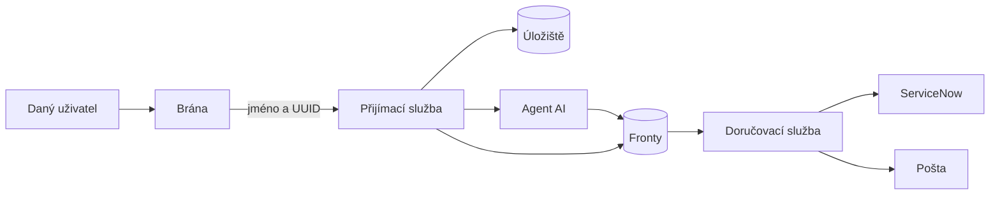
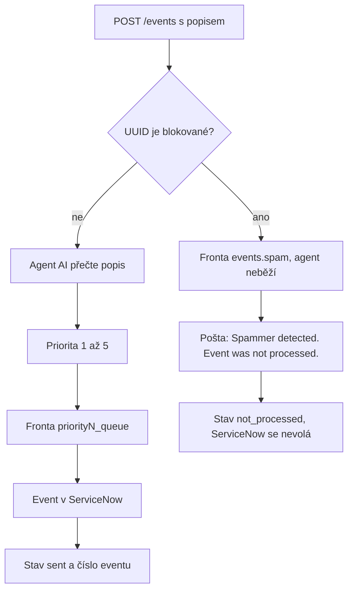
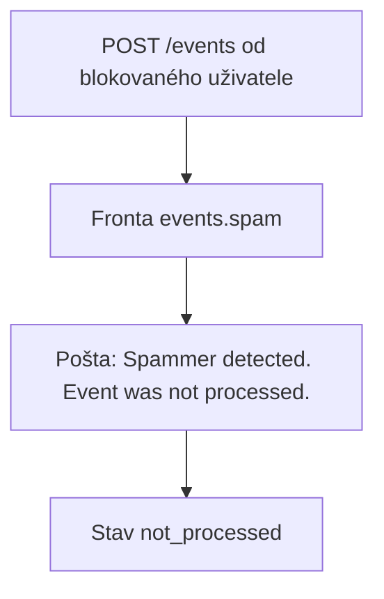
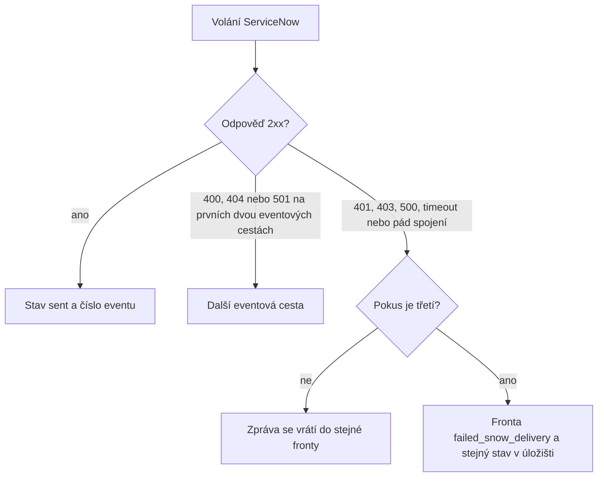
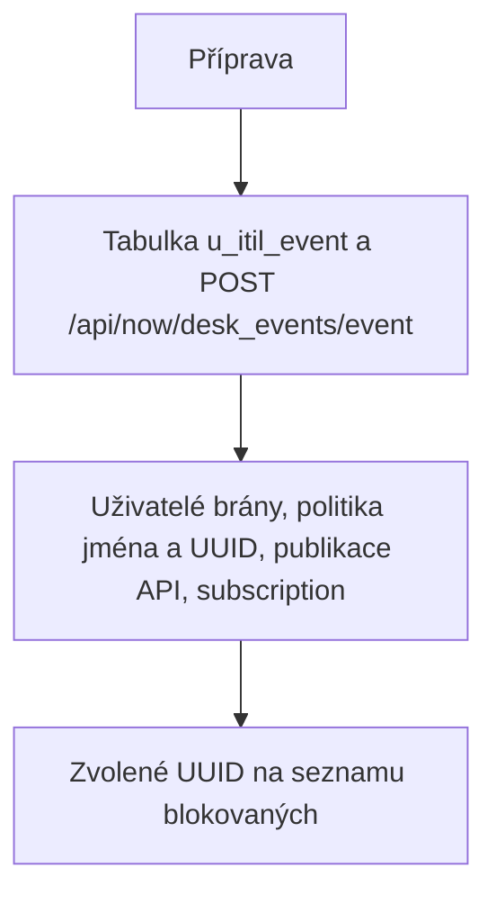

# Jak se aplikace chová

## Použité technologie

- **WSO2 API Manager 4.5.0** je brána. Ověří uživatele a k volání doplní jeho jméno a UUID.
- **Python 3.11 a Quart** jsou přijímací a doručovací služba. Obě běží asynchronně.
- **Agent (AI)** čte popis eventu a určí prioritu 1 až 5. Pracuje ve smyčce Thought, Action, Observation. Model je OpenRouter `poolside/laguna-xs-2.1:free`. Když model není dostupný, stejné kroky dokončí skriptovaný agent.
- **RabbitMQ** nese zprávy mezi přijetím a doručením. Služby s ním mluví přes `aio-pika`.
- **MySQL** drží zprávy a seznam blokovaných uživatelů.
- **ServiceNow** přijme event do tabulky `u_itil_event` přes scripted API. Incidentová tabulka je připravená, vlastní logika incidentu zatím není.
- **SMTP pošta** dostane zprávu, když se event blokovaného uživatele nezpracuje. V ukázce ji chytá Mailpit.
- **Grafana, Loki a Alloy** sbírají logy obou služeb. Dashboard filtruje podle uživatele, correlation id a fronty.

Daný uživatel přijde přes bránu. Brána ho ověří a k volání doplní jeho jméno a UUID. Přijímací služba podle toho UUID a podle textu rozhodne, co se stane. Doručovací služba rozhodnutí dokončí: event zapíše do ServiceNow, nebo pošle poštu, že se event nezpracoval.

UUID počítá brána jako verzi 5 ze jména uživatele. Uživatel si ho do volání nedává a nemůže ho přepsat. Stejné UUID platí pro event i pro incident.



## Fronty v RabbitMQ

Exchange se jmenuje `events` a je direct. Routing key je jméno fronty, takže zpráva spadne právě do jedné. Zprávy jsou trvalé. Přijímací služba frontu jen naplní. Doručovací služba ji vyzvedává a najednou má rozdělaných nejvýš deset zpráv.

| Fronta | Kdo ji plní | Kdo ji bere | Co se stane |
| --- | --- | --- | --- |
| `priority1_queue` až `priority5_queue` | přijímací služba podle priority od agenta (AI) | doručovací služba | Event se zapíše do ServiceNow. |
| `events.spam` | přijímací služba, když je daný uživatel blokovaný | doručovací služba | Pošta `Spammer detected`. ServiceNow se nevolá. |
| `incidents` | přijímací služba | doručovací služba | Obecný řádek v tabulce incident. Vlastní logika incidentu zatím není. |
| `failed_snow_delivery` | doručovací služba po třetím neúspěchu volání ServiceNow | nikdo | Zpráva zůstane ve frontě i se stavem v úložišti. |
| `events.dlq` | doručovací služba, když po třech pokusech selže pošta | nikdo | Zpráva zůstane ve frontě. |

Na snímku je všech devět front. U priorit, u `events.spam` a u `incidents` běží spotřebitel doručovací služby. `failed_snow_delivery` a `events.dlq` spotřebitele nemají. V `failed_snow_delivery` leží jedna zpráva, u které ServiceNow nevrátilo úspěch.


## Use case: uživatel pošle event

Uživatel zavolá `POST /events` a v těle pošle jen popis. Prioritu neuvádí.

Přijímací služba ověří, že UUID je v hlavičce a že popis není prázdný. Když UUID není na seznamu blokovaných, spustí agenta (AI). Agent si přečte popis, zavolá dva nástroje a vrátí prioritu 1 až 5. 1 je nejzávažnější. Zpráva jde do fronty `priority1_queue` až `priority5_queue` a uživatel dostane odpověď 202.

Doručovací služba zprávu vyzvedne a založí event v ServiceNow. Úspěch zapíše ke zprávě jako stav `sent` a číslo eventu. Stejný popis poslaný desetkrát je deset samostatných eventů a deset zápisů do ServiceNow. Když už je UUID blokované, agent neběží, zpráva jde do `events.spam` a doručovací služba jen pošle poštu. Stav je `not_processed`.



Agent (AI) postupuje ve smyčce Thought, Action, Observation a má nejvýš šest kroků.

1. `lookup_service` najde v popisu službu: checkout, payment, database, proxy nebo latency. Když nic nesedí, služba je `unknown`.
2. `classify_priority` navrhne prioritu podle slov v popisu.
3. Agent prioritu potvrdí a přijímací služba podle ní vybere frontu.

| Priorita | Slova v popisu |
| --- | --- |
| 1 | outage, down, unavailable, critical, výpadek |
| 2 | slow, latency, degraded |
| 3 | error, fail, exception, timeout, nebo žádný silný signál |
| 4 | warn, warning, disk |
| 5 | info, notice, recovered, ok |

Když je nastavený klíč, agent volá model. Když klíč chybí nebo model selže, stejné dva kroky dokončí skriptovaný agent a do stopy se zapíše, že se použil. Priorita mimo 1 až 5 se uloží jako 3. Když agent prioritu do šesti kroků neřekne, priorita je také 3. Stopa Thought / Action / Observation zůstane u zprávy.

V přehledu jsou fronty ve sloupcích. Řádek se stavem `sent` je event, který došel do ServiceNow.


Do ServiceNow jde záznam s těmito poli. `severity` je priorita od agenta. `message_key` je id zprávy, takže opakovaný popis nezaloží jeden společný event. Číslo eventu, stav Ready a čas doplní ServiceNow.

```json
{
  "source": "desk",
  "node": "<jméno uživatele>",
  "type": "event",
  "resource": "desk",
  "severity": "1",
  "description": "<popis z volání>",
  "message_key": "<id zprávy>",
  "additional_info": "{\"correlation_id\":\"<id>\",\"user_uuid\":\"<uuid uživatele>\"}"
}
```

Doručovací služba zkouší eventové API v tomto pořadí. Odpověď 400, 404 nebo 501 znamená, že ta cesta na instanci není, a zkusí se další.

1. `POST /api/global/em/jsonv2`
2. `POST /api/now/table/em_event`
3. `POST /api/now/desk_events/event`

Na instanci bez Event Managementu projde třetí volání a řádek skončí v tabulce `u_itil_event`. Úspěch je odpověď 2xx. Z těla se vezme číslo eventu.

## Use case: uživatel je blokovaný

Stejný uživatel zavolá `POST /events` se stejným tvarem těla. Jeho UUID je na seznamu blokovaných.

Přijímací služba agenta nespustí a prioritu nepočítá. Zpráva jde do fronty `events.spam`. Doručovací služba ServiceNow nezavolá. Pošle poštu s předmětem `Spammer detected` a textem, že event nebyl zpracován, spolu se jménem, UUID a id eventu. Stav zprávy je `not_processed`.




Na seznam se uživatel dostane voláním `POST /add_spammer` s jeho UUID. `POST /remove_spammer` ho odebere, `GET /list_spammers` seznam vrátí. Tyto tři cesty chtějí `X-API-Key`, když je klíč nastavený. UUID v těle je uživatel, který se má zablokovat.

## Use case: ServiceNow nevrátí úspěch

Doručovací služba event odešle a ServiceNow vrátí jiný kód než úspěch, nebo spojení spadne. Event se kvůli tomu nezaloží jako incident.



Síťový výpadek se uvnitř jednoho volání zopakuje třikrát, s krátkou pauzou. Hotová chybová odpověď, například 401, 403 nebo 500, se na té vrstvě neopakuje a jde rovnou do fronty. Doručovací služba pak zprávu vrátí do stejné fronty. Po třetím neúspěchu ji přesune do `failed_snow_delivery` a v úložišti nastaví stejný stav. Tu frontu nikdo dál nezpracovává, zpráva tam zůstane i s typem chyby.

Když selže pošta u blokovaného uživatele, platí stejné tři pokusy. Po nich zpráva skončí ve frontě `events.dlq` a stav `failed_snow_delivery` se u ní nenastaví.

## Use case: uživatel pošle incident

`POST /incidents` existuje a přijme stejné tělo i stejné UUID jako event. Vlastní logika incidentu zatím není. Agent (AI) neběží, priorita se nepočítá a do tabulky `u_itil_event` se nic nezapíše. Zpráva jen spadne do fronty `incidents`. Když ji doručovací služba vyzvedne, pošle do tabulky `incident` obecný řádek: krátký popis do 160 znaků, popis, urgency 2 a impact 2.

## Routy a payloady

Brána chrání `POST /events` a `POST /incidents` a doplní na ně jméno a UUID. Ostatní cesty přijímací služby stojí mimo ten uživatelský token. Před cestu brána dává context API a verzi, v téhle definici `/desk/v1`.

| Metoda a cesta | Služba | Chování |
| --- | --- | --- |
| `POST /events` | brána, pak přijímací služba | Use case eventu nebo blokovaného uživatele. |
| `POST /incidents` | brána, pak přijímací služba | Stejné tělo. Vlastní logika incidentu zatím není. |
| `POST /add_spammer` | přijímací služba | Zapíše UUID daného uživatele na seznam blokovaných. |
| `POST /remove_spammer` | přijímací služba | UUID ze seznamu odebere. |
| `GET /list_spammers` | přijímací služba | Vrátí seznam. |
| `GET /` | přijímací služba | Přehled front a stopy agenta. |
| `GET /board` | přijímací služba | Zprávy a seznam blokovaných. Přehled ho čte průběžně. |
| `GET /events/<id>` | přijímací služba | Jedna uložená zpráva. Neznámé id je 404. |
| `GET /healthz` | přijímací i doručovací služba | `{"status":"ok"}`. |
| `GET /readyz` | přijímací i doručovací služba | `{"status":"ready"}`, nebo 503 když úložiště neodpoví. |

Doručovací služba z HTTP bere jen kontrolu zdraví. Zprávy bere z front.

Volání eventu:

```http
POST /events
Authorization: Bearer <token uživatele>
Content-Type: application/json

{"description":"checkout-api outage, payments are down"}
```

Chybějící UUID je 401. Chybějící popis je 400. `short_description` se vezme, když `description` není. Hlavička `X-Correlation-Id` se uloží. Když chybí, služba vytvoří nové id.

Odpověď 202 je uložená zpráva. Stejný tvar leží v úložišti, na frontě a v přehledu:

```json
{
  "id": "<id zprávy>",
  "kind": "event",
  "user_uuid": "<uuid uživatele>",
  "username": "<jméno uživatele>",
  "description": "<popis>",
  "priority": 1,
  "queue_name": "priority1_queue",
  "status": "queued",
  "trace": [],
  "correlation_id": "<id>",
  "servicenow_number": null,
  "created_at": "<čas>"
}
```

`status` pak přejde na `sent`, `not_processed`, nebo `failed_snow_delivery`. `trace` se naplní u eventu, který prošel agentem. U blokovaného uživatele a u incidentu zůstane prázdná. U incidentu je `kind` rovný `incident`, `priority` zůstane prázdná a `queue_name` je `incidents`.

Zápis na seznam blokovaných:

```http
POST /add_spammer
Content-Type: application/json
X-API-Key: <klíč>

{"uuid":"<uuid uživatele>","username":"<jméno uživatele>"}
```

Odpověď je 201. Prázdné UUID je 400, špatný klíč 401. `POST /remove_spammer` stačí `uuid` a vrací 200.

Úspěch scripted API ve ServiceNow je 201 a tělo s číslem eventu. Když číslo v těle není, ke zprávě se uloží `accepted`.

## Příprava

`preparation.py` se spustí jednou, před provozem. Přijímací ani doručovací služba ho nevolá. Nachystá to, na čem use casy stojí: tabulku a API ve ServiceNow, uživatele a subscription na bráně, a jedno zvolené UUID na seznamu blokovaných, aby šel ukázat use case blokovaného uživatele. Hesla a klíče čte z `.env` a do logu je nepíše.



Ve ServiceNow založí tabulku `u_itil_event` se sloupci source, node, type, resource, metric_name, event_class, severity, description, additional_info, message_key, time_of_event, state a event_number. Vlastní sloupce mají prefix `u_`. Scripted API `POST /api/now/desk_events/event` vloží řádek, stav nastaví na Ready, čas na teď a číslo ve tvaru `EM` plus časové razítko. Když už tabulka a API existují, příprava je jen zkontroluje a skript obnoví.

Na bráně založí uživatele pro ukázku, nahraje politiku, která na event a incident doplní jméno a UUID, publikuje API a k němu přihlásí aplikaci tierem Gold.

## Logy

Každý řádek logu je JSON: čas, služba, událost, correlation id, id zprávy, UUID uživatele a fronta. Hesla a tokeny se do logu nedostanou. Alloy je pošle do Loki a Grafana je ukáže na dashboardu. Jde filtrovat podle UUID, correlation id a fronty. Úspěšnost je poměr `sent` ku `sent` plus `failed_snow_delivery`.

Ukázka blokovaného uživatele v logu: `spammer`, zveřejnění do `events.spam`, vyzvednutí, `mail_sent` a `not_processed`. Panel Failed ServiceNow je u tohoto use case prázdný, protože ServiceNow se nevolalo.


