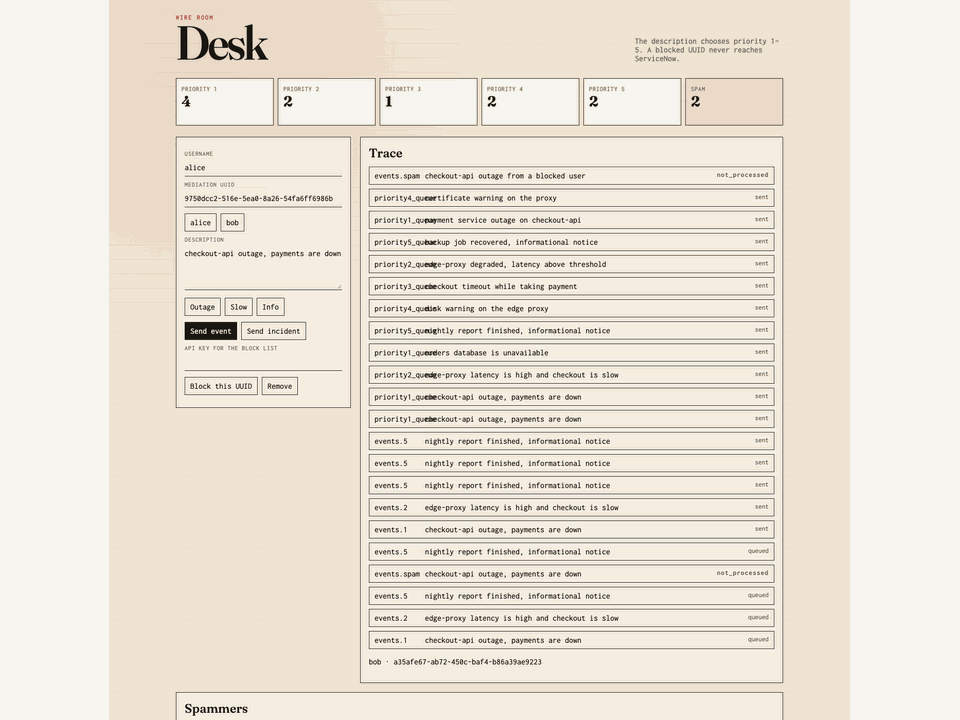
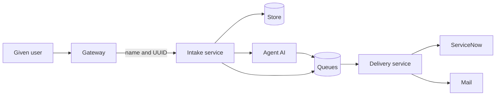
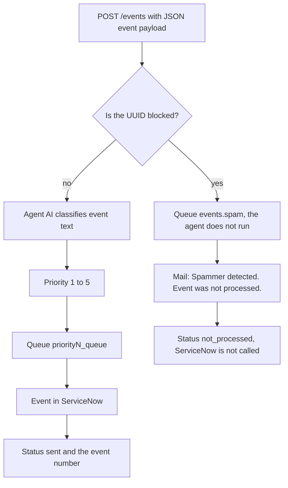
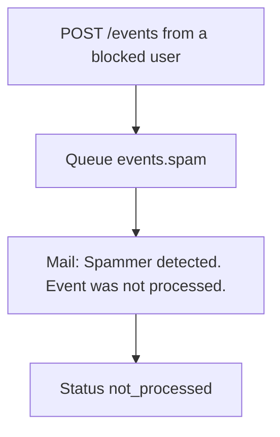
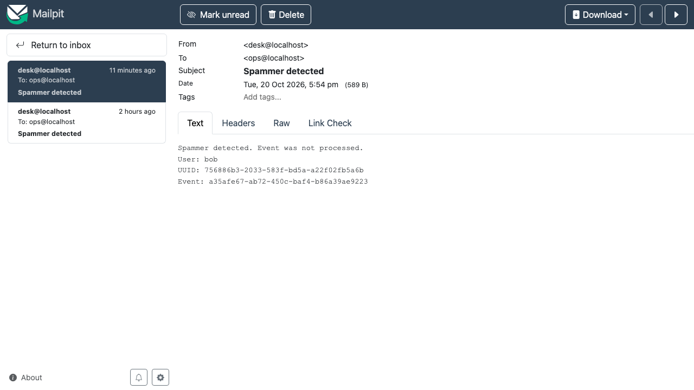
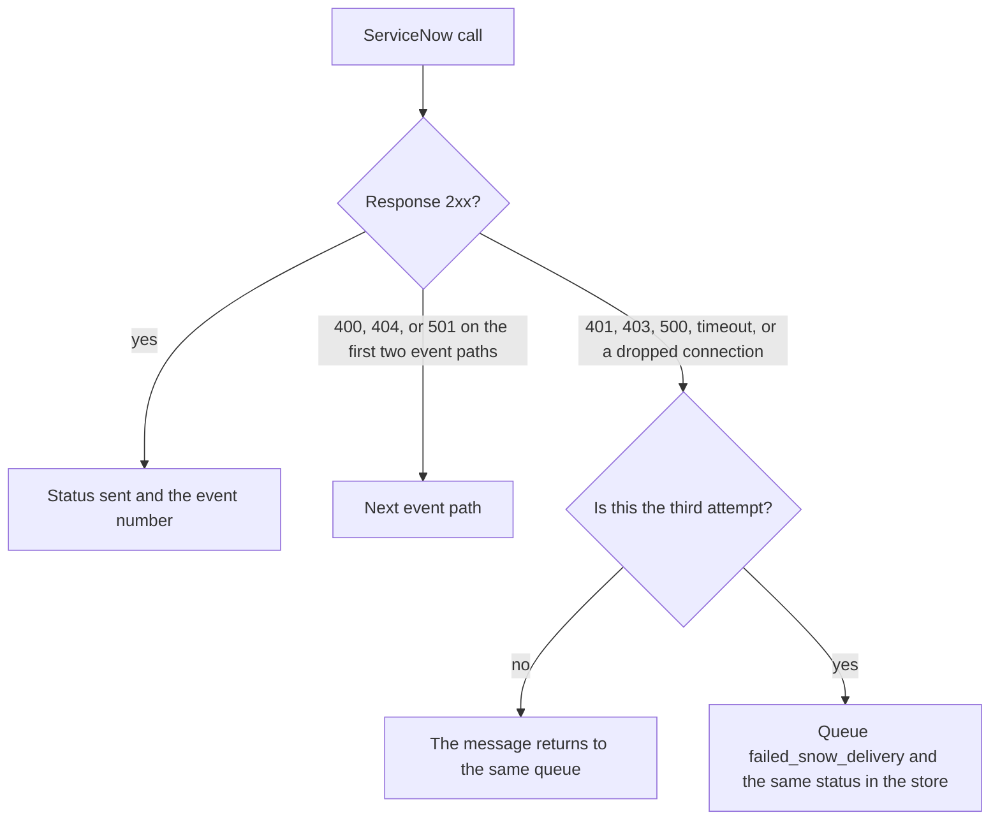
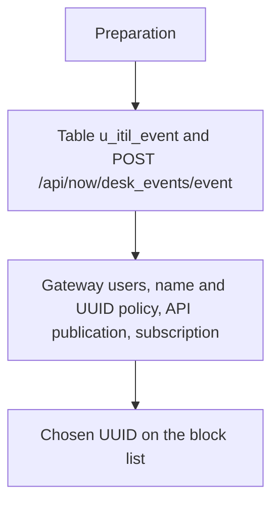

# How the application behaves



## Technologies

- **WSO2 API Manager 4.5.0** is the gateway. It authenticates the user and adds the user's name and UUID to the call.
- **Python 3.11 and Quart** are the intake service and the delivery service. Both run asynchronously.
- **Agent (AI)** reads the event text from the inbound JSON payload and assigns priority 1 to 5. It works in a Thought, Action, Observation loop. The model is OpenRouter `poolside/laguna-xs-2.1:free`. When the model is unavailable, a scripted agent completes the same steps.
- **RabbitMQ** carries messages between intake and delivery. The services talk to it through `aio-pika`.
- **MySQL** stores messages and the list of blocked users.
- **ServiceNow** receives an event into the `u_itil_event` table through a scripted API.
- **SMTP mail** receives a notice when a blocked user's event is left unprocessed. In the demo, Mailpit catches that mail.
- **Grafana, Loki, and Alloy** collect logs from both services. The dashboard filters by user, correlation id, and queue.

A given user comes in through the gateway. The gateway authenticates that user and adds the name and UUID to the call. The intake service validates the JSON event body and decides what happens from that UUID and from the event text. The delivery service maps the queued message to ServiceNow event fields, or sends mail that the event was not processed.

The gateway computes the UUID as version 5 of the username. The user does not send it and cannot override it.



## Queues in RabbitMQ

The exchange is named `events` and it is direct. The routing key is the queue name, so a message lands in exactly one queue. Messages are durable. The intake service only publishes. The delivery service consumes, with at most ten messages in flight.

| Queue | Who fills it | Who reads it | What happens |
| --- | --- | --- | --- |
| `priority1_queue` to `priority5_queue` | intake service, from the agent (AI) priority | delivery service | The event is written to ServiceNow. |
| `events.spam` | intake service, when the given user is blocked | delivery service | Mail `Spammer detected`. ServiceNow is not called. |
| `failed_snow_delivery` | delivery service after the third failed ServiceNow call | nobody | The message stays on the queue, and the store keeps the same status. |
| `events.dlq` | delivery service after the third failed mail attempt | nobody | The message stays on the queue. |

The screenshot shows the eight queues. Priority queues and `events.spam` have a delivery-service consumer. `failed_snow_delivery` and `events.dlq` have none. One message sits in `failed_snow_delivery` from a call ServiceNow did not accept.


## Use case: the user sends an event

The user calls `POST /events` with a **JSON event payload**. Today the body carries the event text in `description` (or `short_description`). **Priority is not in the body** — ingest derives it after classification.

The intake service checks that the UUID header is present and that the payload includes non-empty event text. When the UUID is not on the block list, it starts the agent (AI). The agent reads that text, calls two tools, and returns priority 1 to 5. 1 is the most severe. The enriched message goes to `priority1_queue` through `priority5_queue`, and the caller receives **202** with the stored event envelope (id, queue, correlation id, trace when applicable).

The delivery service picks the message up, builds the ServiceNow event record (source, node, severity, description, message_key, additional_info, …), and posts it. Success is stored on the message as status `sent` and the event number. The **same payload posted ten times** is ten separate events and ten writes to ServiceNow (`message_key` is the message id). When the UUID is already blocked, the agent does not run, the message goes to `events.spam`, and the delivery service only sends mail. The status is `not_processed`.



The agent (AI) proceeds in a Thought, Action, Observation loop and stops after six steps.

1. `lookup_service` finds the service named in the event text: checkout, payment, database, proxy, or latency. When nothing matches, the service is `unknown`.
2. `classify_priority` suggests a priority from the words in that text.
3. The agent confirms the priority and the intake service selects the queue.

| Priority | Words in the event text (description field) |
| --- | --- |
| 1 | outage, down, unavailable, critical, výpadek |
| 2 | slow, latency, degraded |
| 3 | error, fail, exception, timeout, or no strong signal |
| 4 | warn, warning, disk |
| 5 | info, notice, recovered, ok |

When a key is configured, the agent calls the model. When the key is missing or the model fails, a scripted agent completes the same two steps and the trace records that it was used. A priority outside 1 to 5 is stored as 3. When the agent does not name a priority within six steps, the priority is also 3. The Thought / Action / Observation trace stays on the message.

The overview shows the queues in columns. A row with status `sent` is an event that reached ServiceNow.


ServiceNow receives a record with these fields. `severity` is the priority from the agent. `message_key` is the message id, so a repeated inbound payload does not collapse into one event. ServiceNow fills in the event number, the state Ready, and the time.

```json
{
  "source": "desk",
  "node": "<username>",
  "type": "event",
  "resource": "desk",
  "severity": "1",
  "description": "<description from the call>",
  "message_key": "<message id>",
  "additional_info": {
    "correlation_id": "<id>",
    "user_uuid": "<user uuid>"
  }
}
```

The delivery service tries the event APIs in this order. A response of 400, 404, or 501 means that path does not exist on the instance, and the next path is tried.

1. `POST /api/global/em/jsonv2`
2. `POST /api/now/table/em_event`
3. `POST /api/now/desk_events/event`

On an instance without Event Management, the third call succeeds and the row lands in `u_itil_event`. Success is a 2xx response. The event number is taken from the body.

## Use case: the user is blocked

The same user calls `POST /events` with the same JSON event payload. That user's UUID is on the block list.

The intake service does not start the agent and does not compute a priority. The message goes to `events.spam`. The delivery service does not call ServiceNow. It sends mail with the subject `Spammer detected` and a body saying the event was not processed, plus the username, UUID, and event id. The message status is `not_processed`.





A user is added to the list with `POST /add_spammer` and that user's UUID. `POST /remove_spammer` removes the UUID. `GET /list_spammers` returns the list. These three routes require `X-API-Key` when a key is configured. The UUID in the body is the user to block.

## Use case: ServiceNow does not return success

The delivery service sends the event and ServiceNow returns a status other than success, or the connection fails. The event stays an event.



A network failure is repeated three times inside one call, with a short pause. A finished error response, such as 401, 403, or 500, is not repeated at that layer and goes straight to the queue handling. The delivery service then puts the message back on the same queue. After the third failure it moves the message to `failed_snow_delivery` and sets the same status in the store. Nothing consumes that queue. The message stays there with the error type.

When mail for a blocked user fails, the same three attempts apply. After that the message lands on `events.dlq`, and its status is not set to `failed_snow_delivery`.

## Routes and payloads

The gateway protects `POST /events` and adds the name and UUID there. The other intake routes sit outside that user token. The gateway prefixes the path with the API context and version, in this definition `/desk/v1`.

| Method and path | Service | Behaviour |
| --- | --- | --- |
| `POST /events` | gateway, then intake service | The event use case, or the blocked-user use case. |
| `POST /add_spammer` | intake service | Stores the given user's UUID on the block list. |
| `POST /remove_spammer` | intake service | Removes the UUID from the list. |
| `GET /list_spammers` | intake service | Returns the list. |
| `GET /` | intake service | Overview of the queues and the agent trace. |
| `GET /board` | intake service | Messages and the block list. The overview polls it. |
| `GET /events/<id>` | intake service | One stored message. An unknown id is 404. |
| `GET /healthz` | intake and delivery | `{"status":"ok"}`. |
| `GET /readyz` | intake and delivery | `{"status":"ready"}`, or 503 when the store does not answer. |

The delivery service accepts only the health checks over HTTP. It takes messages from the queues.

**Inbound event payload** (through the gateway as `POST /desk/v1/events`):

```http
POST /events
Authorization: Bearer <user token>
Content-Type: application/json

{"description":"checkout-api outage, payments are down"}
```

Optional header: `X-Correlation-Id` (stored on the message; generated when absent).

Validation: a missing `X-User-Uuid` is **401**. Event text is required — empty `description` and `short_description` is **400**. `short_description` is used when `description` is absent. The OpenAPI schema is `Payload` in `openapi.yaml` (`description` / `short_description`; no priority field).

The 202 response is the stored message. The same shape sits in the store, on the queue, and in the overview:

```json
{
  "id": "<message id>",
  "kind": "event",
  "user_uuid": "<user uuid>",
  "username": "<username>",
  "description": "<description>",
  "priority": 1,
  "queue_name": "priority1_queue",
  "status": "queued",
  "trace": [],
  "correlation_id": "<id>",
  "servicenow_number": null,
  "created_at": "<time>"
}
```

`status` then becomes `sent`, `not_processed`, or `failed_snow_delivery`. `trace` is filled for an event that went through the agent. It stays empty for a blocked user.

These three calls go to the intake service. They use `X-API-Key` when `API_KEY` is set. A missing or wrong key is 401. A missing or blank `uuid` on the two POST calls is 400.

Add a user:

```http
POST /add_spammer
Content-Type: application/json
X-API-Key: <key>

{"uuid":"<user uuid>","username":"<username>"}
```

```http
HTTP/1.1 201 Created
Content-Type: application/json

{"uuid":"<user uuid>","username":"<username>"}
```

Calling it again for the same UUID updates the username and still returns 201 with the same shape. When `username` is left out, the response has `"username": null`.

Remove a user:

```http
POST /remove_spammer
Content-Type: application/json
X-API-Key: <key>

{"uuid":"<user uuid>"}
```

```http
HTTP/1.1 200 OK
Content-Type: application/json

{"uuid":"<user uuid>"}
```

The same 200 is returned when that UUID was not on the list.

List the blocked users:

```http
GET /list_spammers
X-API-Key: <key>
```

```http
HTTP/1.1 200 OK
Content-Type: application/json

{
  "spammers": [
    {
      "uuid": "<user uuid>",
      "username": "<username>",
      "created_at": "<time>"
    }
  ]
}
```

An empty list is `{"spammers": []}`.

A successful scripted API call in ServiceNow is 201 and a body with the event number. When the body has no number, the message stores `accepted`.

## Preparation

`preparation.py` runs once, before traffic. The intake service and the delivery service do not call it. It creates what the use cases stand on: the ServiceNow table and API, the gateway users and subscription, and one chosen UUID on the block list so the blocked-user use case can be shown. It reads passwords and keys from `.env` and does not write them to the log.



In ServiceNow it creates the table `u_itil_event` with columns source, node, type, resource, metric_name, event_class, severity, description, additional_info, message_key, time_of_event, state, and event_number. Custom columns get the prefix `u_`. The scripted API `POST /api/now/desk_events/event` inserts a row, sets the state to Ready, sets the time to now, and sets the number to `EM` plus a timestamp. When the table and API already exist, preparation checks them and refreshes the script.

On the gateway it creates the demo users, uploads the policy that adds the name and UUID on an event, publishes the API, and subscribes an application on the Gold tier.

## Logs

Each log line is JSON: time, service, event, correlation id, message id, user UUID, and queue. Passwords and tokens are left out of the log. Alloy ships the lines to Loki and Grafana shows them on the dashboard. They can be filtered by UUID, correlation id, and queue. The success rate is `sent` divided by `sent` plus `failed_snow_delivery`.

A blocked user in the log looks like this: `spammer`, a publish to `events.spam`, a consume, `mail_sent`, and `not_processed`. The Failed ServiceNow panel is empty for this use case, because ServiceNow was not called.


