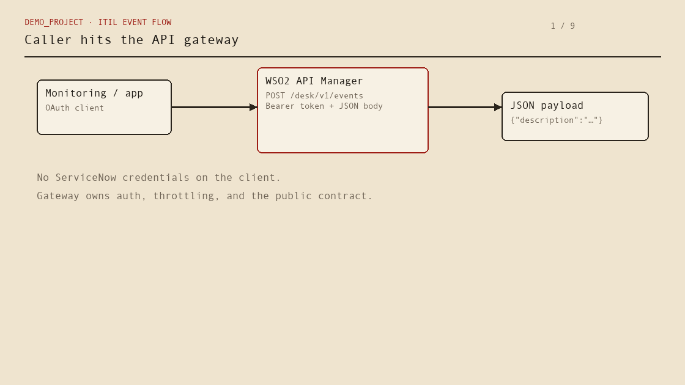
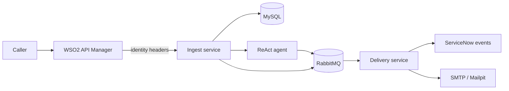
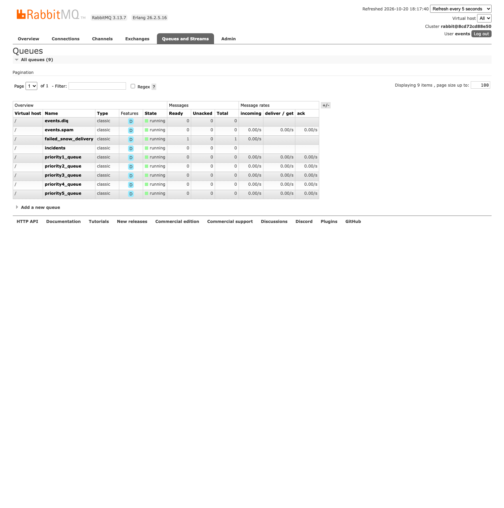
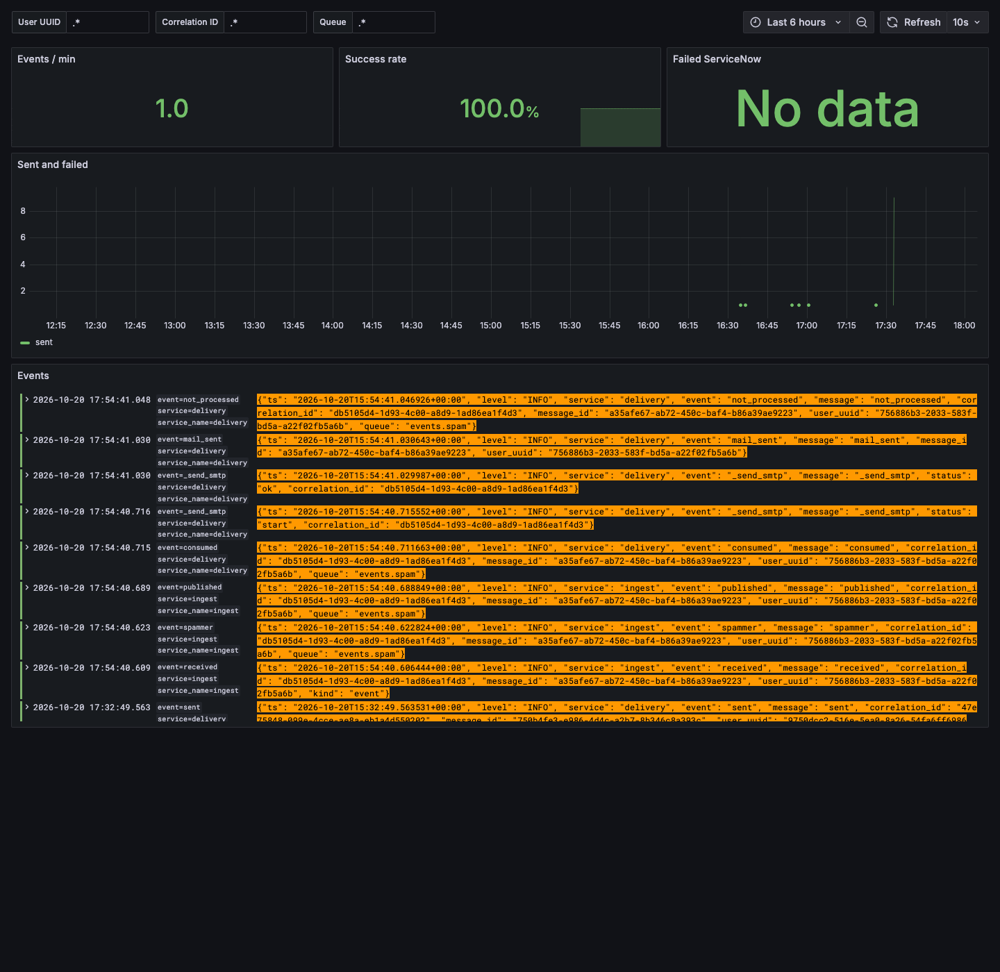

# Demo_project

[](https://github.com/matpet00/Demo_project/actions/workflows/ci.yml)

## Overview

**Demo_project** is an **ITIL Event Management** pipeline in front of ServiceNow — not a shortcut to the Table API. Callers authenticate at **WSO2 API Manager** and post a JSON event payload; a **ReAct agent** (with a scripted fallback) reads the text and assigns priority **1–5**; **RabbitMQ** buffers the handoff; a delivery worker writes an **event** to ServiceNow or handles suppression and failures on their own queues. Identity comes from the gateway, not from the client body.

The point is to show that path with the awkward cases still visible: the same payload twice is two events; a **blocked sender** never reaches ServiceNow (spam queue → mail, `not_processed`); ServiceNow errors retry and then land on **`failed_snow_delivery`** without being rewritten as incidents; the agent trace stays on the message for the board and logs. Platform setup lives in **`preparation.py`**, not in the request hot path. Deeper behaviour → **[FLOW.md](FLOW.md)**.



**[▶ Interactive flow tour](https://matpet00.github.io/Demo_project/flow.html)** — click each step, use ← →, or **Play tour**. Standard event and **blocked sender (bob → events.spam)** branches.

Screenshots montage: [overview.gif](docs/images/overview.gif)

**Quick review without Docker:** `python -m pip install -e ".[test]" && make test` (22 pytest cases, in-memory broker and store).

---

## The story in one pass

Monitoring feeds and integrations produce **events** — early signals. ITIL treats Event Management as the stage that filters, correlates, and prioritizes those signals *before* opening incidents or changes. That is what this code models.

**Inbound event payload** (through the gateway, e.g. `POST /desk/v1/events`):

```json
{
  "description": "checkout-api outage, payments are down"
}
```

`short_description` is accepted when `description` is omitted. Priority is **not** in the body — the ingest service derives it. WSO2 mediation supplies `X-User-Name` and `X-User-Uuid` (UUID v5 from the username); the client cannot spoof them.

1. **Gateway** — OAuth, API product, throttling. Mediation attaches caller identity to every event call.
2. **Ingest (Quart, async)** — validate the JSON payload, persist the message, check the block list, run a **ReAct agent** (OpenRouter with a **ScriptedBrain** fallback) on the event text to assign priority 1–5, publish the enriched message to RabbitMQ, return **202** with the stored event envelope (id, queue, correlation id, trace).
3. **Delivery (Quart, async)** — consume from priority queues, map the queued message to ServiceNow event fields (`source`, `node`, `severity`, `description`, `message_key`, `additional_info`, …), or send mail when the sender is blocked. Retry ServiceNow; after three failures, park the message on `failed_snow_delivery` — still an event, not silently morphed into something else.
4. **Observability** — one JSON log line per step; Alloy → Loki → Grafana, filterable by user, correlation id, and queue.



---

## AI triage — ReAct agent (not a chatbot on the side)

Priority is **never** sent by the client. Ingest hands the event text to a **ReAct loop** in `agents.py`: the model (or fallback) alternates **Thought → Action → Observation** until it can assign **1–5** and pick `priority1_queue` … `priority5_queue`.

| | |
| --- | --- |
| **Model** | OpenRouter `poolside/laguna-xs-2.1:free` when `OPENROUTER_API_KEY` is set |
| **Tools** | `lookup_service(description)` — maps wording to checkout-api, edge-proxy, orders-db, … |
| | `classify_priority(description)` — keyword rules suggest severity 1–5 |
| **Fallback** | `ScriptedBrain` runs the same two tool calls if the key is missing or the API fails — demos and CI stay green |
| **Observability** | Full trace on the message; the event board shows each step |
| **When AI is skipped** | Blocked UUID → `events.spam` with **no** agent run (suppression beats classification) |

This is deliberate integration AI: bounded tools, testable fallback, no “LLM writes directly to ServiceNow.” The interactive tour has a dedicated **ReAct agent** step; unit tests cover both model-shaped and scripted paths.

---

## WSO2 + queues vs. calling the Table API from every client

Table API is the right tool for admin scripts and one-off sync jobs. It is a poor **front door** when many systems emit events, load is bursty, or you need a clear security boundary.

| | Direct Table API | Demo_project (WSO2 → ingest → RabbitMQ → delivery) |
| --- | --- | --- |
| **Credentials** | ServiceNow user/token on each integrator | OAuth at WSO2; backends trust gateway headers |
| **Spikes & rate limits** | Callers block or fail with the platform | Accept fast; queue absorbs backlog |
| **Architecture** | Business logic and retries in N clients | Small services: accept, classify, deliver |
| **Delivery guarantees** | Retry storms → duplicate rows or drops | Durable queues, bounded retries, inspectable dead letters |
| **Routing** | Priority often reimplemented per client | Five priority queues + spam + failure paths |
| **Audit** | Reconstructing “who sent what” is painful | Correlation id + user UUID on every log line |

WSO2 owns subscription and policy at the edge. RabbitMQ is the handoff between “we accepted the work” and “ServiceNow confirmed it.” That seam is where you add enrichment, correlation, or extra consumers later without changing the public API.

---

## ITIL Event Management — what the demo encodes

| Principle | How it shows up here |
| --- | --- |
| Events are not incidents | Delivery writes to the event table (or stops before ServiceNow for blocked senders). |
| Triage reduces noise | ReAct agent + tools assign 1–5; routing follows queue priority. |
| Suppression is explicit | Block list → `events.spam`, email, status `not_processed`. |
| Failed handling stays in the event lane | `failed_snow_delivery` holds messages after retry exhaustion — for operators, not auto-incident creation. |

The same event payload posted ten times → ten distinct events (`message_key` per message). That is intentional (typical monitoring semantics). Idempotency helpers exist in code but are **not** wired to ingestion, so the behaviour stays honest in tests and demos.

---

## RabbitMQ topology

Exchange `events` (direct). Routing key = queue name. Durable messages. Ingest publishes only; delivery consumes with bounded prefetch.

| Queue | Role |
| --- | --- |
| `priority1_queue` … `priority5_queue` | Classified events → ServiceNow |
| `events.spam` | Blocked sender → mail only |
| `failed_snow_delivery` | ServiceNow failed after retries |
| `events.dlq` | Mail failed after retries |



Blocked-user mail and ServiceNow failure paths (with screenshots) are walked through in [FLOW.md](FLOW.md).

---

## Tech stack

| Layer | Choice |
| --- | --- |
| API gateway | WSO2 API Manager 4.5.0 |
| Services | Python 3.11, Quart, aio-pika |
| **AI classification** | **ReAct agent** — OpenRouter + tool calls; **ScriptedBrain** fallback (`agents.py`) |
| Messaging | RabbitMQ 3.13 |
| State | MySQL (messages, block list) |
| Target CMDB | ServiceNow (`u_itil_event` via scripted REST from `preparation.py`) |
| Mail (demo) | Mailpit |
| Logs | Grafana, Loki, Alloy |

**Setup vs runtime:** `preparation.py` creates WSO2 users, API subscription, ServiceNow artefacts, and demo data. Application containers do not import it — provisioning stays out of the request path.

---

## Run it

**Reviewing the project without installing anything:** use the [interactive flow tour](https://matpet00.github.io/Demo_project/flow.html) and `make test` (see [Tests](#tests)). That is enough to follow the architecture and behaviour.

**Full stack (optional, for developers with Docker):**

```bash
cp .env.example .env
python build.py
```

`build.py` runs unit tests, builds images, starts Compose, smoke-checks priority routing and spammer mail, then waits for provisioning. One-shot setup without the long bring-up: `python preparation.py` (WSO2 users, API subscription, ServiceNow table, demo block list).

The Compose stack includes WSO2 API Manager (~4 GB RAM, slow start), RabbitMQ, MySQL, ingest and delivery services, Grafana/Loki/Alloy, and Mailpit. After everything is healthy on **your machine**, open the event board, Mailpit, Grafana, and RabbitMQ management on the ports defined in `docker-compose.yml`. Gateway `curl` examples and payloads are in **[FLOW.md](FLOW.md)**.

`make demo` posts sample events (including a blocked user) against a running ingest service. Optional env: `OPENROUTER_API_KEY`, ServiceNow credentials (mock delivery works without them).

---

## Tests

```bash
python -m pip install -e ".[test]"
make test
```

22 pytest cases; in-memory store and broker — no WSO2, MySQL, or Grafana required.

| File | Responsibility |
| --- | --- |
| `api.py` / `delivery.py` | HTTP ingest and queue consumer |
| `agents.py` | ReAct loop, OpenRouter brain, ScriptedBrain fallback |
| `rabbitmq.py` | Topology and I/O |
| `servicenow.py` | Event push (live + mock) |
| `logging_setup.py` | Structured JSON to stdout |
| `docs/flow.html` + `render_flow_gif.py` | Interactive tour and GIF capture source |


