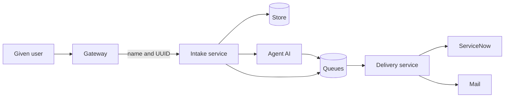
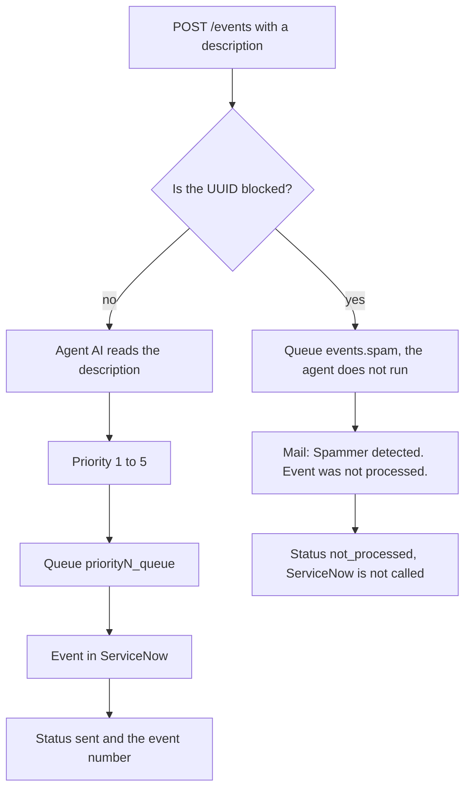

# Desk

A caller authenticates at WSO2 API Manager and posts an event. The gateway adds the user's name and UUID. One async Python service then decides what happens. An AI agent reads the description and assigns priority 1–5, and a blocked user is stopped before any ticket exists. RabbitMQ carries every accepted call as its own message. A second service delivers it to ServiceNow, or sends mail when the user is blocked.

The project is there to show that path with the failure cases left visible. The same description sent ten times becomes ten events. A ServiceNow error is retried and then parked on its own queue, and it is not rewritten as an incident. A blocked user gets an email that the event was not processed. Logs are one JSON line each and show up in Grafana, filterable by user, correlation id, and queue. Users, the API subscription, and the ServiceNow event table are created once by `preparation.py`, so the running services only accept, route, and deliver. Routes, payloads, and the block-list responses are in [FLOW.md](FLOW.md).

## Technologies

- **WSO2 API Manager 4.5.0** is the gateway. It authenticates the user and adds the user's name and UUID to the call.
- **Python 3.11 and Quart** are the intake service and the delivery service. Both run asynchronously.
- **Agent (AI)** reads the event description and assigns priority 1 to 5. It works in a Thought, Action, Observation loop. The model is OpenRouter `poolside/laguna-xs-2.1:free`. When the model is unavailable, a scripted agent completes the same steps.
- **RabbitMQ** carries messages between intake and delivery. The services talk to it through `aio-pika`.
- **MySQL** stores messages and the list of blocked users.
- **ServiceNow** receives an event into the `u_itil_event` table through a scripted API.
- **SMTP mail** receives a notice when a blocked user's event is left unprocessed. In the demo, Mailpit catches that mail.
- **Grafana, Loki, and Alloy** collect logs from both services. The dashboard filters by user, correlation id, and queue.

A given user comes in through the gateway. The gateway computes the UUID as version 5 of the username. The user does not send it and cannot override it. The intake service decides what happens from that UUID and from the text. The delivery service writes an event to ServiceNow, or sends mail that the event was not processed.



## Queues

The exchange is named `events` and it is direct. The routing key is the queue name, so a message lands in exactly one queue. Messages are durable. The intake service only publishes. The delivery service consumes, with at most ten messages in flight.

| Queue | Who fills it | Who reads it | What happens |
| --- | --- | --- | --- |
| `priority1_queue` to `priority5_queue` | intake service, from the agent (AI) priority | delivery service | The event is written to ServiceNow. |
| `events.spam` | intake service, when the given user is blocked | delivery service | Mail `Spammer detected`. ServiceNow is not called. |
| `failed_snow_delivery` | delivery service after the third failed ServiceNow call | nobody | The message stays on the queue, and the store keeps the same status. |
| `events.dlq` | delivery service after the third failed mail attempt | nobody | The message stays on the queue. |


## Use case: the user sends an event

The user calls `POST /events` and sends only a description. The body has no priority. When the UUID is not on the block list, the agent reads the description, calls `lookup_service` and `classify_priority`, and returns priority 1 to 5. 1 is the most severe. The message goes to `priority1_queue` through `priority5_queue`. The delivery service creates an event in ServiceNow and stores status `sent` with the event number. The same description sent ten times is ten events.



| Priority | Words in the description |
| --- | --- |
| 1 | outage, down, unavailable, critical, výpadek |
| 2 | slow, latency, degraded |
| 3 | error, fail, exception, timeout, or no strong signal |
| 4 | warn, warning, disk |
| 5 | info, notice, recovered, ok |

When the model key is missing or the model fails, a scripted agent completes the same two steps. A priority outside 1 to 5 is stored as 3. The Thought / Action / Observation trace stays on the message.


## Use case: the user is blocked

The same call, with that user's UUID on the block list, does not start the agent. The message goes to `events.spam`. The delivery service sends mail with the subject `Spammer detected` and a body saying the event was not processed, plus the username, UUID, and event id. The status is `not_processed`.

`POST /add_spammer`, `POST /remove_spammer`, and `GET /list_spammers` manage that list. The request and response bodies are in [FLOW.md](FLOW.md).


## Use case: ServiceNow does not return success

The delivery service tries `/api/global/em/jsonv2`, then `/api/now/table/em_event`, then `/api/now/desk_events/event`. A 400, 404, or 501 on the first two paths means that path is not on the instance. Any other failure is retried. After the third failure the message moves to `failed_snow_delivery` and stays an event. Nothing consumes that queue. When mail for a blocked user fails three times, that message goes to `events.dlq`.

## Run

```bash
cp .env.example .env
python build.py
```

`build.py` runs the unit tests, builds every image, starts Compose, checks the three priorities and the spammer mail, then waits until preparation finishes. `python preparation.py` on its own creates the WSO2 users, the API subscription, the ServiceNow event table, and bob's spammer row.

Then open:

- Desk: http://localhost:8080
- Mailpit: http://localhost:8025
- Grafana: http://localhost:3000 (anonymous admin, Loki is already attached)
- RabbitMQ: http://localhost:15672 (`events` / `events`)
- WSO2 Publisher: https://localhost:9443/publisher (`admin` / `admin`)

`docker compose up` also starts WSO2, which needs about 4 GB of RAM and a few minutes. After it is healthy, the `provision` container creates users `alice` and `bob`, publishes `POST /events`, and attaches the mediation. Passwords for those two users come from `.env`. The container log prints their UUIDs and the application client id.

Call the gateway with the password grant so the mediation can see the username:

```bash
curl -k -u "$CLIENT_ID:$CLIENT_SECRET" \
  -d "grant_type=password&username=alice&password=$WSO2_ALICE_PASSWORD" \
  https://localhost:9443/oauth2/token
```

```bash
curl -k -H "Authorization: Bearer $TOKEN" \
  -H "Content-Type: application/json" \
  -d '{"description":"checkout-api is down"}' \
  https://localhost:8243/desk/v1/events
```

`make demo` talks to ingest directly with the same UUIDs the mediation would set. It sends three descriptions and one event from `bob` after blocking that UUID. The desk shows the trace and the queue. Mailpit shows the spammer mail.

## Model

`OpenAICompatibleBrain` calls OpenRouter model `poolside/laguna-xs-2.1:free`. Put the key in `OPENROUTER_API_KEY`. It is not committed. If the key is missing or the free quota fails, `ScriptedBrain` runs the same loop from the wording of the description.

## ServiceNow

Set `SERVICENOW_BASE_URL`, `SERVICENOW_USER`, and `SERVICENOW_PASSWORD` in `.env`. Events go to `/api/global/em/jsonv2`, then to the `em_event` table. This instance has neither, so `python preparation.py` creates `u_itil_event` and `POST /api/now/desk_events/event`. A failed event stays an event: it is retried and then parked on `failed_snow_delivery`. Without those variables the delivery service uses an in-memory mock (`EM0010001`, `INC0010001`).

## Logs

`logging_setup.py` writes one JSON object per line to stdout: time, service, event, correlation id, message id, user UUID, and queue. Passwords are dropped. Alloy ships container stdout to Loki. In Grafana, filter `{service=~"ingest|delivery"}` or search a `correlation_id`.

## Tests

```bash
python -m pip install -e ".[test]"
make test
```

The tests do not start WSO2, MySQL, or Grafana. They use an in-memory store and broker.

## Layout

`api.py` and `delivery.py` are the two processes. `agents.py` is the loop. `rabbitmq.py` is `aio_pika`. `servicenow.py` only sends events. `mail.py`, `store.py`, `decorators.py`, and `logging_setup.py` are the rest of the runtime. `preparation.py` creates the WSO2 users, the API subscription, the ServiceNow event table, and bob's spammer row. `@idempotent` is implemented and tested, and it is not wrapped around event delivery: a repeated payload is a new event.
