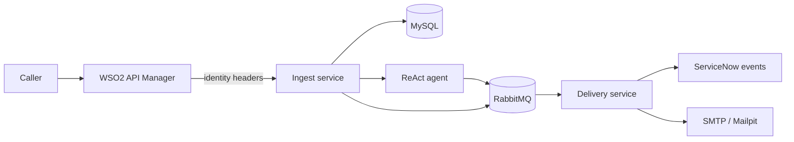
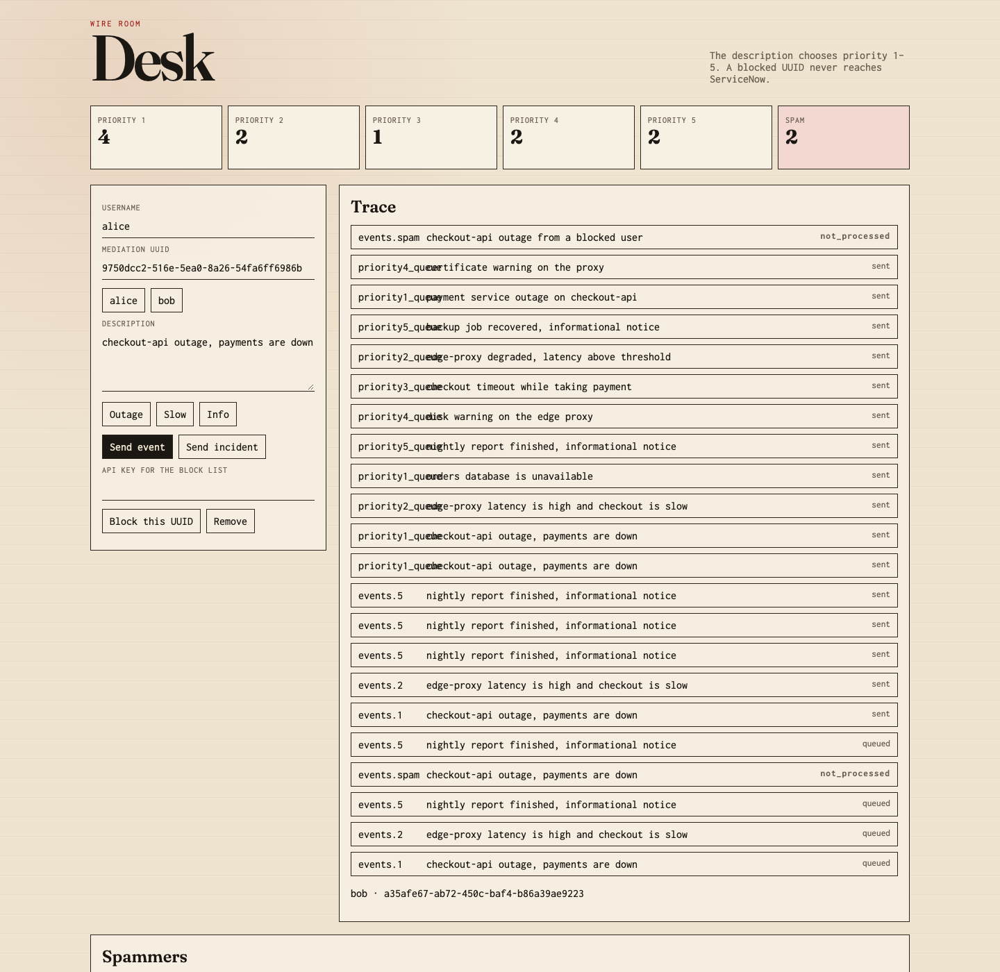

# Demo_project

If you hire integrators who only know “POST to ServiceNow and parse the response,” you get fragile scripts. This repo shows the other pattern: **ITIL Event Management** with a real gateway, async workers, and queues — so spikes, retries, and bad senders do not become ticket chaos or lost messages.

Callers authenticate at **WSO2 API Manager** and send a plain description. The platform classifies severity, routes by priority, and delivers an **event** to ServiceNow (not an incident). Failures stay visible: dedicated queues, structured logs in Grafana, setup separated from runtime code.

Full behaviour, payloads, and diagrams → **[FLOW.md](FLOW.md)**.

---

## The story in one pass

Monitoring feeds and integrations produce **events** — early signals. ITIL treats Event Management as the stage that filters, correlates, and prioritizes those signals *before* opening incidents or changes. That is what this code models.

1. **Gateway** — OAuth, API product, throttling. Mediation sets `X-User-Name` and `X-User-Uuid` (UUID v5 from the username). The client cannot spoof identity.
2. **Ingest (Quart, async)** — persist the request, check the block list, run a **ReAct agent** (OpenRouter with a **ScriptedBrain** fallback) to assign priority 1–5, publish to RabbitMQ, return 202 quickly.
3. **Delivery (Quart, async)** — consume from priority queues, create the event in ServiceNow, or send mail when the sender is blocked. Retry ServiceNow; after three failures, park the message on `failed_snow_delivery` — still an event, not silently morphed into something else.
4. **Observability** — one JSON log line per step; Alloy → Loki → Grafana, filterable by user, correlation id, and queue.





---

## WSO2 + queues vs. calling the Table API from every client

Table API is the right tool for admin scripts and one-off sync jobs. It is a poor **front door** when many systems emit events, load is bursty, or you need a clear security boundary.

| | Direct Table API | Demo_project (WSO2 → ingest → RabbitMQ → delivery) |
| --- | --- | --- |
| **Credentials** | ServiceNow user/token on each integrator | OAuth at WSO2; backends trust gateway headers |
| **Spikes & rate limits** | Callers block or fail with the platform | Accept fast; queue absorbs backlog |
| **Architecture** | Business logic and retries in N clients | Small services: accept, classify, deliver |
| **Delivery guarantees** | Retry storms → duplicate rows or drops | Durable queues, bounded retries, inspectable dead letters |
| **Routing** | Priority often reimplemented per client | Five priority queues + spam + failure paths |
| **Audit** | Reconstructing “who sent what” is painful | Correlation id + user UUID on every log line |

WSO2 owns subscription and policy at the edge. RabbitMQ is the handoff between “we accepted the work” and “ServiceNow confirmed it.” That seam is where you add enrichment, correlation, or extra consumers later without changing the public API.

---

## ITIL Event Management — what the demo encodes

| Principle | How it shows up here |
| --- | --- |
| Events are not incidents | Delivery writes to the event table (or stops before ServiceNow for blocked senders). |
| Triage reduces noise | AI + rules assign 1–5; routing follows queue priority. |
| Suppression is explicit | Block list → `events.spam`, email, status `not_processed`. |
| Failed handling stays in the event lane | `failed_snow_delivery` holds messages after retry exhaustion — for operators, not auto-incident creation. |

Same description sent ten times → ten events. That is intentional (typical monitoring semantics). Idempotency helpers exist in code but are **not** wired to ingestion, so the behaviour stays honest in tests and demos.

---

## RabbitMQ topology

Exchange `events` (direct). Routing key = queue name. Durable messages. Ingest publishes only; delivery consumes with bounded prefetch.

| Queue | Role |
| --- | --- |
| `priority1_queue` … `priority5_queue` | Classified events → ServiceNow |
| `events.spam` | Blocked sender → mail only |
| `failed_snow_delivery` | ServiceNow failed after retries |
| `events.dlq` | Mail failed after retries |


Blocked-user mail and ServiceNow failure paths (with screenshots) are walked through in [FLOW.md](FLOW.md).

---

## Tech stack

| Layer | Choice |
| --- | --- |
| API gateway | WSO2 API Manager 4.5.0 |
| Services | Python 3.11, Quart, aio-pika |
| Classification | ReAct agent (`poolside/laguna-xs-2.1:free` via OpenRouter) + scripted fallback |
| Messaging | RabbitMQ 3.13 |
| State | MySQL (messages, block list) |
| Target CMDB | ServiceNow (`u_itil_event` via scripted REST from `preparation.py`) |
| Mail (demo) | Mailpit |
| Logs | Grafana, Loki, Alloy |

**Setup vs runtime:** `preparation.py` creates WSO2 users, API subscription, ServiceNow artefacts, and demo data. Application containers do not import it — provisioning stays out of the request path.

---

## Run it

```bash
cp .env.example .env
python build.py
```

`build.py` runs tests, builds images, starts Compose, smoke-checks priorities and spammer mail, waits for provisioning. Setup only: `python preparation.py`.

| UI | URL |
| --- | --- |
| Event board | http://localhost:8080 |
| Mailpit | http://localhost:8025 |
| Grafana | http://localhost:3000 |
| RabbitMQ management | http://localhost:15672 (`events` / `events`) |
| WSO2 Publisher | https://localhost:9443/publisher (`admin` / `admin`) |

WSO2 needs ~4 GB RAM and a few minutes to start. The `provision` container registers `alice` / `bob`, publishes the API, applies mediation — check logs for UUIDs and OAuth client id.

**Through the gateway:**

```bash
curl -k -u "$CLIENT_ID:$CLIENT_SECRET" \
  -d "grant_type=password&username=alice&password=$WSO2_ALICE_PASSWORD" \
  https://localhost:9443/oauth2/token
```

```bash
curl -k -H "Authorization: Bearer $TOKEN" \
  -H "Content-Type: application/json" \
  -d '{"description":"checkout-api is down"}' \
  https://localhost:8243/desk/v1/events
```

`make demo` calls ingest directly with the same UUIDs mediation would inject (three normal events + one blocked user).

**Env:** `OPENROUTER_API_KEY` optional (fallback brain). ServiceNow vars optional (in-memory mock for local delivery).

---

## Tests

```bash
python -m pip install -e ".[test]"
make test
```

21 pytest cases; in-memory store and broker — no WSO2, MySQL, or Grafana required.

| File | Responsibility |
| --- | --- |
| `api.py` / `delivery.py` | HTTP ingest and queue consumer |
| `agents.py` | ReAct loop |
| `rabbitmq.py` | Topology and I/O |
| `servicenow.py` | Event push (live + mock) |
| `logging_setup.py` | Structured JSON to stdout |


